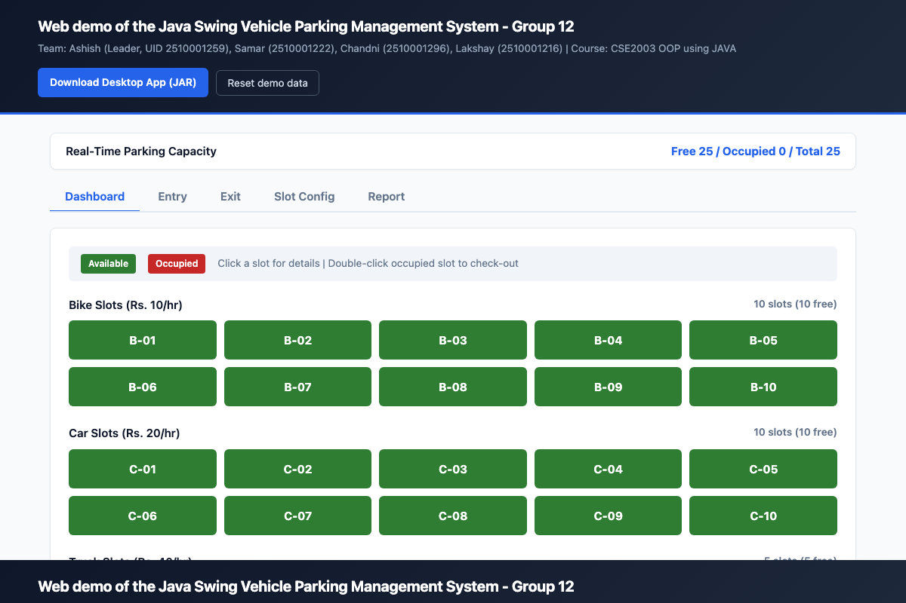
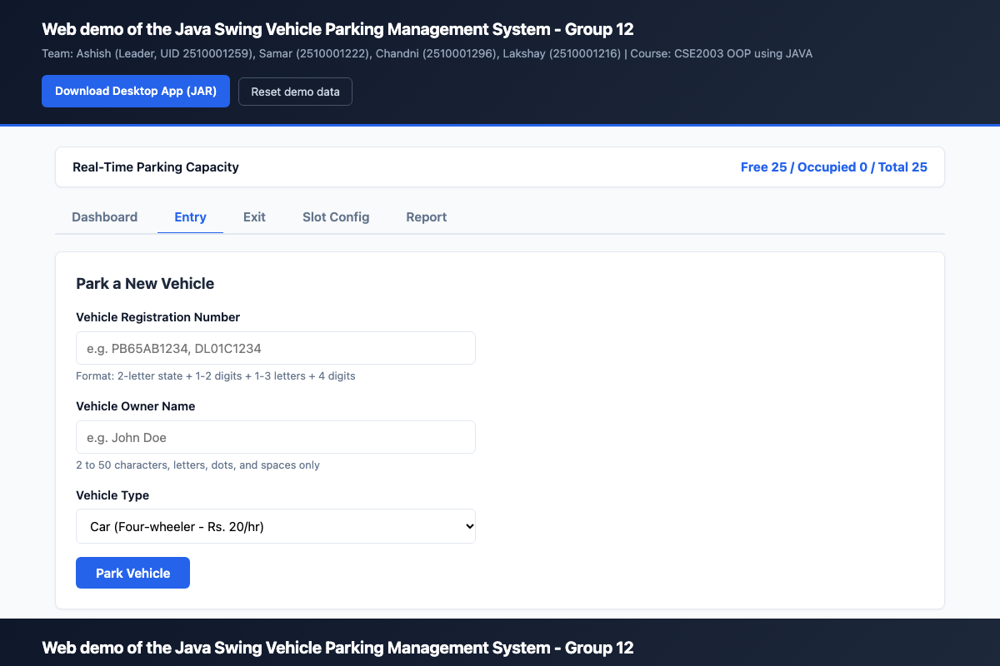
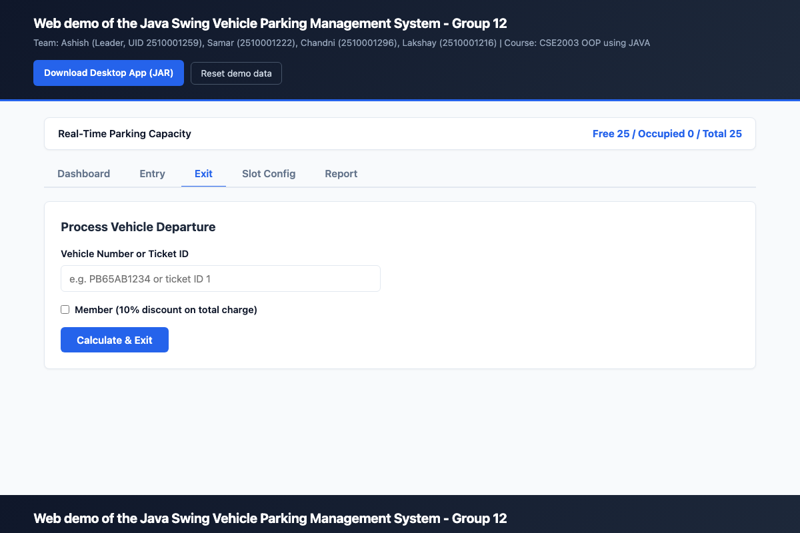
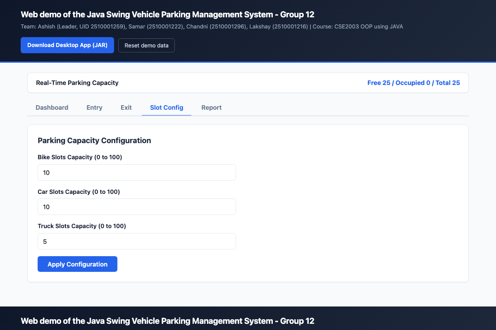
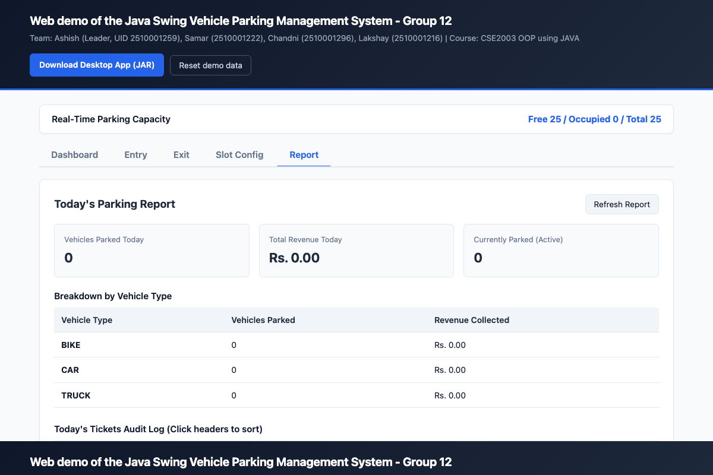

# Vehicle Parking Management System

[](https://www.oracle.com/java/)
[](https://maven.apache.org/)
[](https://www.formdev.com/flatlaf/)
[](https://www.sqlite.org/)
[](LICENSE)

A robust, multi-threaded Desktop and Web application designed to automate vehicle parking allocations, track real-time entry and departure, apply tiered hourly rates with membership discounts, and generate audit reports.

---

## 👥 Project Information & Team Members
- **Course**: CSE2003 | Object Oriented Programming using JAVA | B.Tech CSE Semester 3
- **Group**: Group 12
- **Project Title**: Vehicle Parking Management System

| Name | Role | University ID (UID) |
| :--- | :--- | :--- |
| **Ashish** | Team Leader & System Architect | **2510001259** |
| **Samar** | Core Developer (Database & Service Layer) | **2510001222** |
| **Chandni** | UI/UX Developer (Swing & Web Demo) | **2510001296** |
| **Lakshay** | QA & Test Automation Engineer | **2510001216** |

---

## 🌐 Live Web Demo & Releases
- **Live Deployed Web Demo (GitHub Pages)**: [https://<GITHUB_USERNAME>.github.io/vehicle-parking-management-system/](https://<GITHUB_USERNAME>.github.io/vehicle-parking-management-system/)
- **Executable Desktop Fat JAR Release**: [Download v1.0 JAR](https://github.com/<GITHUB_USERNAME>/vehicle-parking-management-system/releases/latest)

---

## 📋 Features & Functional Modules

1. **Dashboard Module**:
   - Interactive 5-column grid layout for Bike, Car, and Truck slots.
   - Distinct color coding: **Green (#2E7D32)** for Available, **Red (#C62828)** for Occupied.
   - Hover highlight transitions on mouse events.
   - Single-click inspection modal displaying running duration and running charge.
   - Double-click an occupied slot to immediately transition to the Exit tab with vehicle number pre-filled.
   - Autonomous background daemon thread refreshes slot status every 3 seconds.

2. **Vehicle Entry Module**:
   - Automatic slot allocation picking the lowest slot ID of the matching vehicle category.
   - Input validation enforcing Indian vehicle registration format and valid owner names.
   - Duplicate entry prevention (blocks vehicles that currently hold an active ticket).
   - Capacity exhaustion handling via custom checked `ParkingFullException`.
   - Issues detailed digital parking ticket upon check-in.

3. **Vehicle Exit & Billing Module**:
   - Dual search mechanism: by vehicle registration number or numeric ticket ID.
   - Automated duration calculation: ceiling of minutes divided by 60, with a 1-hour minimum charge.
   - Optional 10% Member discount toggle with automatic receipt recalculation.
   - Atomic database transaction frees slot, records exit time, and completes ticket.

4. **Slot Configuration Module**:
   - Dynamic capacity scaling (0 to 100 slots per type) for Bikes, Cars, and Trucks.
   - Increase capacity: appends new slots (e.g., B-11, B-12).
   - Decrease capacity: removes only highest-numbered free slots without prior ticket history.
   - Strictly refuses deletion if slot has historical ticket records.

5. **Reporting & Audit Module**:
   - Daily totals: Total vehicles parked today, total revenue collected, active parked vehicles.
   - Category breakdown table showing counts and revenue for Bikes, Cars, and Trucks.
   - Searchable, sortable audit table of all tickets issued today using `TableRowSorter`.

---

## 🎓 Syllabus Concepts to Code Mapping

Every core unit of the CSE2003 Java syllabus is implemented and explicitly commented across the codebase:

| Syllabus Unit | Key Concept | Exact Implementation File | Description / Code Location |
| :--- | :--- | :--- | :--- |
| **Unit 1: Classes & Objects** | Class Design & Encapsulation | `com.group12.parking.model.Slot`<br>`com.group12.parking.model.Ticket` | Encapsulated fields with private access modifiers, public getters/setters, formatted `toString()`. |
| **Unit 1: Method Overloading** | Compile-Time Polymorphism | `com.group12.parking.service.FeeCalculator` | Four overloaded variants of `calculateFee(...)` handling duration, types, membership, and Ticket DTOs. |
| **Unit 1: Constructors Overloading**| Constructor Overloading | `com.group12.parking.model.Ticket` | Overloaded constructors for newly issued active tickets vs full records reconstructed from DB. |
| **Unit 2: Inheritance** | Superclass & Subclass | `com.group12.parking.model.Vehicle`<br>`Bike`, `Car`, `Truck` | Concrete vehicle subclasses inherit common attributes from abstract `Vehicle` via `super()` constructor calls. |
| **Unit 2: Abstract Classes** | Abstract Methods & Templates | `com.group12.parking.model.Vehicle` | Abstract methods `getRatePerHour()` and `getType()` enforced on all subclasses. |
| **Unit 2: Interfaces** | Interface Implementation | `com.group12.parking.model.Chargeable` | Interface `Chargeable` implemented by `Vehicle` to provide standard fee computation. |
| **Unit 2: Polymorphism** | Dynamic Method Dispatch & Factory | `com.group12.parking.model.Vehicle.create(...)` | Vehicle factory returning polymorphic subclass instances executed via abstract superclass references. |
| **Unit 3: Custom Exceptions** | Checked Exception Hierarchy | `com.group12.parking.exception.ParkingFullException`<br>`com.group12.parking.exception.ParkingException` | Custom checked exceptions declared, thrown on business violations, and caught gracefully in UI dialogs. |
| **Unit 3: Multithreading** | Runnable & Daemon Thread | `com.group12.parking.thread.SlotStatusUpdater` | `SlotStatusUpdater` implements `Runnable`, scheduled via `ScheduledExecutorService` as a background daemon. |
| **Unit 3: Synchronization** | Thread Safety & Concurrency | `com.group12.parking.service.ParkingService` | `synchronized` allotment and exit methods prevent race conditions across concurrent parking attempts. |
| **Unit 4: JDBC & Architecture** | Connection & Statements | `com.group12.parking.dao.DBManager` | Singleton connection manager configuring PRAGMA foreign keys and SQLite busy timeout. |
| **Unit 4: DAO & SQL Injection** | Parameterized Queries | `com.group12.parking.dao.SlotDAO`<br>`VehicleDAO`, `TicketDAO` | PreparedStatements with bound parameters across all CRUD operations; zero string concatenation. |
| **Unit 4: Transactions** | ACID Commit & Rollback | `com.group12.parking.service.ParkingService` | Multi-table atomic transactions using `setAutoCommit(false)`, `commit()`, and `rollback()` on exceptions. |
| **Unit 5: Swing Layouts** | Layout Managers | `com.group12.parking.ui.DashboardPanel`<br>`MainFrame`, `EntryPanel` | Practical combinations of `GridLayout` (5 columns), `BorderLayout`, `BoxLayout`, and `GridBagLayout`. |
| **Unit 5: Event Handling** | MouseAdapter & Listeners | `com.group12.parking.ui.SlotButton` | Custom `MouseAdapter` with `mouseEntered`/`mouseExited` hover styling, single-click, and double-click actions. |
| **Unit 5: Dialogs & Tables** | Modern Swing Components | `com.group12.parking.ui.ReportPanel`<br>`UiUtils` | `JTable` with non-editable `DefaultTableModel`, `TableRowSorter`, and `JOptionPane` custom message dialogs. |

---

## 🗄️ Database Architecture & Schema

The application uses an embedded SQLite database (`parking.db`). On initial startup, if the tables are empty, it automatically creates the schema and seeds 25 default slots (10 Bikes, 10 Cars, 5 Trucks).

```sql
CREATE TABLE slots (
  slot_id INTEGER PRIMARY KEY AUTOINCREMENT,
  slot_number TEXT NOT NULL UNIQUE,        -- e.g. B-01, C-01, T-01
  vehicle_type TEXT NOT NULL CHECK(vehicle_type IN ('BIKE','CAR','TRUCK')),
  is_occupied INTEGER NOT NULL DEFAULT 0   -- 0: free, 1: occupied
);

CREATE TABLE vehicles (
  vehicle_id INTEGER PRIMARY KEY AUTOINCREMENT,
  vehicle_number TEXT NOT NULL UNIQUE,     -- e.g. PB65AB1234
  vehicle_type TEXT NOT NULL CHECK(vehicle_type IN ('BIKE','CAR','TRUCK')),
  owner_name TEXT NOT NULL
);

CREATE TABLE parking_tickets (
  ticket_id INTEGER PRIMARY KEY AUTOINCREMENT,
  vehicle_id INTEGER NOT NULL REFERENCES vehicles(vehicle_id),
  slot_id INTEGER NOT NULL REFERENCES slots(slot_id),
  entry_time TEXT NOT NULL,                -- ISO-8601 string
  exit_time TEXT,                          -- NULL while parked
  fee REAL,                                -- NULL while parked
  status TEXT NOT NULL CHECK(status IN ('ACTIVE','COMPLETED'))
);
```

### Entity-Relationship (ER) Overview
- **Vehicles (1) <---> (M) Parking Tickets**: One vehicle can visit multiple times and accumulate past completed tickets, but can have at most one `ACTIVE` ticket at any time.
- **Slots (1) <---> (M) Parking Tickets**: Each parking slot has an audit trail of tickets issued for it. A slot can only be occupied by one active ticket at a time.
- **Foreign Keys**: Enforced via `PRAGMA foreign_keys = ON;` and multi-statement transactional rollback.

---

## 💰 Pricing & Billing Rules

| Vehicle Type | Rate per Hour | Member Discount | Billable Duration Rule |
| :--- | :--- | :--- | :--- |
| **Bike (Two-wheeler)** | Rs. 10.00 / hr | 10% Off | $\text{billable\_hours} = \max(1, \lceil \text{minutes} / 60.0 \rceil)$ |
| **Car (Four-wheeler)** | Rs. 20.00 / hr | 10% Off | $\text{billable\_hours} = \max(1, \lceil \text{minutes} / 60.0 \rceil)$ |
| **Truck (Heavy vehicle)** | Rs. 40.00 / hr | 10% Off | $\text{billable\_hours} = \max(1, \lceil \text{minutes} / 60.0 \rceil)$ |

- **Minimum Charge**: Minimum 1 hour billing even for short stays (< 60 min).
- **Rounding Rule**: Any fraction of an hour past 60 minutes rolls over into the next full hour (e.g., 61 minutes = 2 billable hours).
- **Member Discount**: 10% discount deducted from total fee when the "Member" option is selected.

---

## 🛠️ Tech Stack & Build Tools

- **Core Runtime**: Java 17+ (LTS)
- **Build System**: Apache Maven 3.9+
- **Look & Feel**: FlatLaf 3.5.4 (`com.formdev:flatlaf`)
- **Database**: SQLite 3.47.2 (`org.xerial:sqlite-jdbc`)
- **Unit Testing**: JUnit Jupiter 5.10.2 (`org.junit.jupiter:junit-jupiter`)
- **Packaging**: Maven Shade Plugin 3.5.2 (creates self-contained fat runnable JAR)
- **Web Demo**: Vanilla HTML5, CSS3, ES6 JavaScript with offline localStorage persistence.

---

## 🚀 How to Run the Application

### Prerequisites
- JDK 17 or higher (`java -version`)
- Maven 3.8+ (`mvn -version`) or Maven wrapper

### 1. Build and Run via Maven
```bash
# Clone the repository
git clone https://github.com/<GITHUB_USERNAME>/vehicle-parking-management-system.git
cd vehicle-parking-management-system

# Clean compile, execute test suite, and package fat JAR
mvn clean package

# Run the desktop application
java -jar target/vehicle-parking-management-system-1.0.jar
```

### 2. Run All Unit Tests
```bash
mvn test
```
*All 22 unit tests run against an isolated in-memory/temporary SQLite database with zero side effects on production data.*

---

## 📁 Project Structure Tree

```
vehicle-parking-management-system/
├── pom.xml                                # Maven build definition and shade configuration
├── LICENSE                                # MIT Open Source License
├── README.md                              # Project documentation & viva guide
├── docs/                                  # GitHub Pages Web Demo deployment
│   ├── .nojekyll                          # Disables Jekyll processing on GitHub Pages
│   ├── index.html                         # Full-featured responsive web application
│   └── screenshots/                       # Captured user interface screenshots
│       ├── dashboard.png
│       ├── entry.png
│       ├── exit.png
│       ├── config.png
│       └── report.png
└── src/
    ├── main/
    │   └── java/
    │       └── com/
    │           └── group12/
    │               └── parking/
    │                   ├── Main.java                          # Main entry point & EDT launch
    │                   ├── dao/
    │                   │   ├── DBManager.java                 # SQLite JDBC Singleton & schema initialization
    │                   │   ├── SlotDAO.java                   # CRUD and allocation for slots
    │                   │   ├── TicketDAO.java                 # Ticket audit logging and exit updates
    │                   │   └── VehicleDAO.java                # Vehicle upsert and lookup
    │                   ├── exception/
    │                   │   ├── ParkingException.java          # Checked business exception
    │                   │   └── ParkingFullException.java      # Checked capacity exhaustion exception
    │                   ├── model/
    │                   │   ├── Bike.java                      # Concrete Bike model (Unit 2)
    │                   │   ├── Car.java                       # Concrete Car model (Unit 2)
    │                   │   ├── Chargeable.java                # Polymorphic interface (Unit 2)
    │                   │   ├── Slot.java                      # Slot entity (Unit 1)
    │                   │   ├── Ticket.java                    # Ticket entity (Unit 1)
    │                   │   ├── Truck.java                     # Concrete Truck model (Unit 2)
    │                   │   ├── Vehicle.java                   # Abstract Vehicle superclass (Unit 2)
    │                   │   └── VehicleType.java               # Enum for BIKE, CAR, TRUCK
    │                   ├── service/
    │                   │   ├── FeeCalculator.java             # Overloaded calculation service (Unit 1)
    │                   │   ├── ParkingService.java            # Synchronized business orchestration (Unit 3, 4)
    │                   │   ├── ReceiptInfo.java               # Departure receipt DTO
    │                   │   └── ReportData.java                # Aggregated report DTO
    │                   ├── thread/
    │                   │   └── SlotStatusUpdater.java         # Scheduled daemon refresh thread (Unit 3)
    │                   ├── ui/
    │                   │   ├── DashboardPanel.java            # Visual 5-column slot grid (Unit 5)
    │                   │   ├── EntryPanel.java                # Vehicle check-in form (Unit 5)
    │                   │   ├── ExitPanel.java                 # Departure & receipt billing form (Unit 5)
    │                   │   ├── MainFrame.java                 # Top-level window & navigation (Unit 5)
    │                   │   ├── ReportPanel.java               # Daily metrics & JTable log (Unit 5)
    │                   │   ├── SlotButton.java                # Interactive MouseAdapter button (Unit 5)
    │                   │   ├── SlotConfigPanel.java           # Capacity adjustment spinner form (Unit 5)
    │                   │   └── UiUtils.java                   # Formatting and standard dialog helpers
    │                   └── util/
    │                       ├── Constants.java                 # Application rates, defaults, regex
    │                       └── Validator.java                 # Number plate and owner validation
    └── test/
        └── java/
            └── com/
                └── group12/
                    └── parking/
                        ├── model/
                        │   └── PolymorphismTest.java          # Polymorphic dispatch tests
                        ├── service/
                        │   ├── FeeCalculatorTest.java         # Overloaded fee math verification
                        │   └── ParkingServiceTest.java        # Multi-case service & DB integration tests
                        └── util/
                            └── ValidatorTest.java             # Regex and normalization tests
```

---

## 📸 Screenshots

### 1. Dashboard View


### 2. Vehicle Entry Form


### 3. Vehicle Exit & Billing


### 4. Slot Configuration Panel


### 5. Daily Audit Report


---

## 📌 Assumptions & Design Choices

1. **Database Path & Auto-Seeding**: The desktop application operates on an embedded SQLite database `parking.db` placed in the current working directory. The path is configurable via `DBManager.setDbPath(...)`, which unit tests utilize with `@TempDir` to execute tests in complete isolation.
2. **Headless Execution Support**: In headless server environments (such as CI/CD runners lacking display servers), `Main.java` detects `GraphicsEnvironment.isHeadless()` and completes database initialization and schema validation safely without attempting to display visual frames.
3. **Slot Deletion Protection**: When downscaling capacity in the Slot Config module, slots that possess historical records in `parking_tickets` are protected against deletion to maintain referential integrity.
4. **Web Demo Parity**: Because standard Java Swing code cannot execute natively within web browsers, `docs/index.html` replicates the exact business logic, fee calculation mathematics, plate normalization rules, and modal dialogs using vanilla ES6 JavaScript and HTML5 localStorage.
